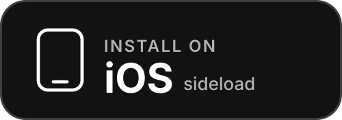
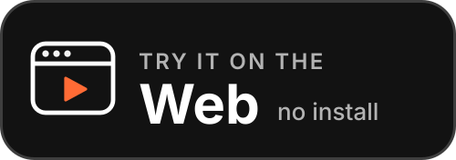
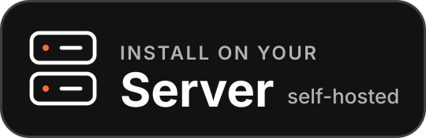
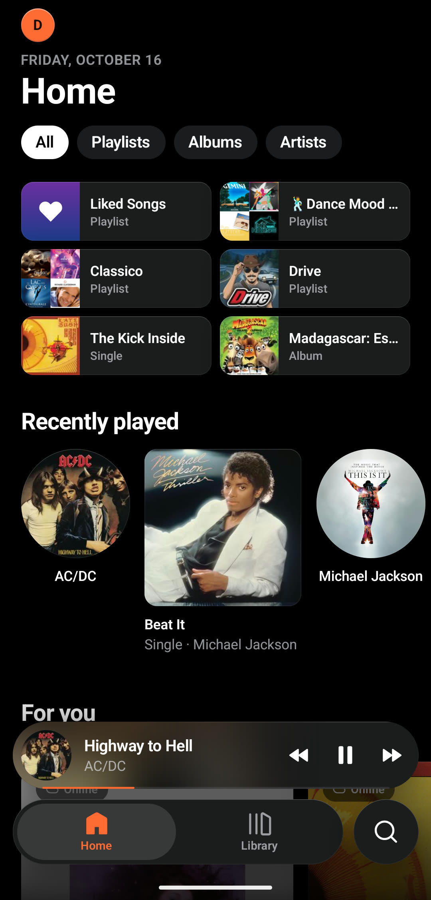
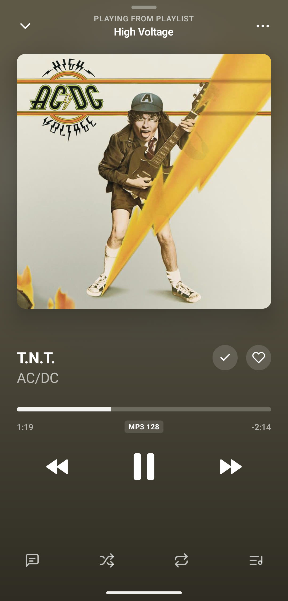
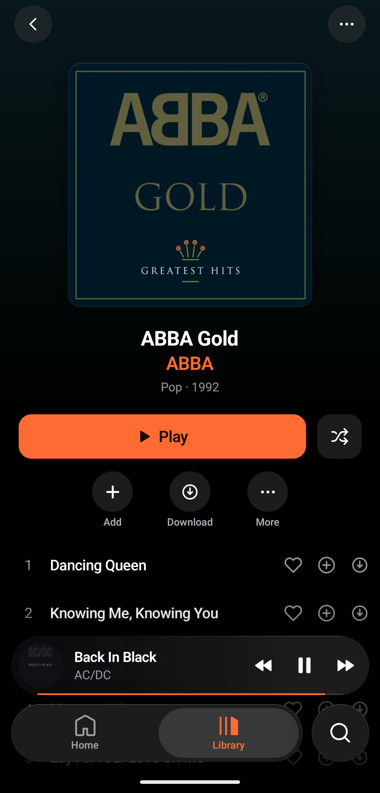
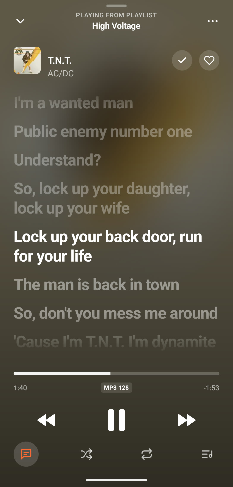
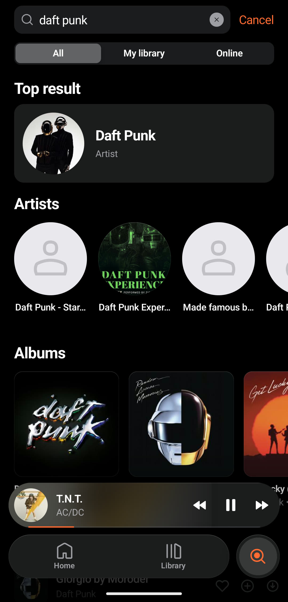
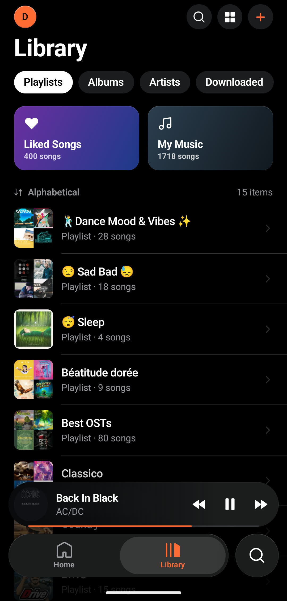
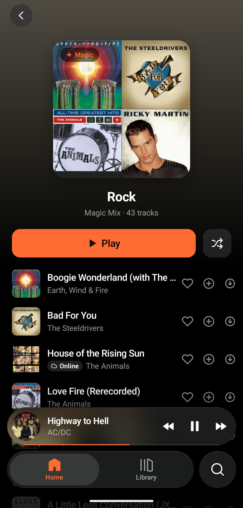

<div align="center">


# Musonic

**Your music, your server, beautifully played.**

Apps for Android, iOS and the browser, and **Musonic Server** to host your library yourself.
Also works with Navidrome and any Subsonic-compatible server.

<a href="https://doodzprog.github.io/Musonic/"></a>

<a href="https://github.com/DoodzProg/Musonic/releases/latest/download/Musonic.apk"></a>
&nbsp;
<a href="https://github.com/DoodzProg/Musonic/releases/latest/download/Musonic.ipa"></a>

<a href="https://doodzprog.github.io/Musonic/app/"></a>
&nbsp;
<a href="apps/server/README.md#build-and-run"></a>

[](https://github.com/DoodzProg/Musonic/releases/latest)
[](https://github.com/DoodzProg/Musonic/releases?q=web-v&expanded=true)
[](https://github.com/DoodzProg/Musonic/actions/workflows/ci.yml)
[](https://github.com/DoodzProg/Musonic/actions/workflows/ci-web.yml)
[](https://github.com/DoodzProg/Musonic/actions/workflows/server-ci.yml)





</div>

---

## Contents

- [What's inside](#whats-inside)
- [Install](#install)
- [Connect your server](#connect-your-server)
- [Privacy](#privacy)
- [Screenshots](#screenshots)
- [Repository layout](#repository-layout)
- [Development](#development)
- [Releases and CI](#releases-and-ci)
- [Known limitations](#known-limitations)
- [Contributing](#contributing) · [License](#license)

---

## What's inside

### Musonic for Android and iOS
A calm, fast music app: full-screen player with synced lyrics, a queue you can reorder, Shuffle Magic, Magic Mixes by genre, a home built from what you play, offline downloads (Wi-Fi first), separate streaming quality on Wi-Fi and mobile data, Android Auto (beta), English and French.
→ [`apps/mobile`](apps/mobile) · [changelog](apps/mobile/CHANGELOG.md)

### Musonic Web
The complete Musonic in a desktop browser: home, search, library, synced lyrics, full-screen player, floating mini player, keyboard and media keys. **Import a Spotify or Deezer playlist** from its address (with Musonic Server). Use it [online](https://doodzprog.github.io/Musonic/app/), nothing to install, or host it yourself.
→ [`apps/web`](apps/web) · [changelog](apps/web/CHANGELOG.md)

### Musonic Server
One server for your music: scans your folders, serves the Musonic apps and any Subsonic client, adds an **online catalogue** next to your library (like or add an online song to a playlist, it is imported as a file), **imports playlists** from Spotify and Deezer, keeps every device of an account **in sync in real time**, backs itself up every day. Written in Rust: fast, and light on memory.
→ [`apps/server`](apps/server) · [changelog](apps/server/CHANGELOG.md)

### Administration console
Served by Musonic Server at its own address: accounts by invitation link (the administrator never sees a password), rights and quotas, live dashboard and data usage, imports and providers, library checks (missing files, duplicates), devices and security, settings, backups, logs and an activity journal.
→ [`apps/admin`](apps/admin)

---

## Install

| What | How |
|---|---|
| **Android** 7.0+ | Download [`Musonic.apk`](https://github.com/DoodzProg/Musonic/releases/latest/download/Musonic.apk) and open it. The app tells you when a new version is out. |
| **iOS** 15.1+ | Unsigned [`Musonic.ipa`](https://github.com/DoodzProg/Musonic/releases/latest/download/Musonic.ipa), to install with AltStore or Sideloadly. No App Store release is planned. |
| **Web** | **Online** at [doodzprog.github.io/Musonic/app](https://doodzprog.github.io/Musonic/app/), or **self-hosted**: `Musonic-Web.zip` from the latest [`web-v` release](https://github.com/DoodzProg/Musonic/releases?q=web-v&expanded=true), see [`SELF-HOSTING.md`](apps/web/SELF-HOSTING.md). Musonic Server can also install it for you at `/app`. |
| **Server** | Docker or a single binary: see [Musonic Server, build and run](apps/server/README.md#build-and-run). Coming from Navidrome? Your playlists, likes and plays [come along](apps/server/README.md#coming-from-navidrome). |

No Musonic account, no cloud, no API key: the apps only talk to your own server, plus a few public services described in [Privacy](#privacy).

---

## Connect your server

On first launch, enter your server's address, username and password. Musonic tells you clearly what went wrong (wrong password, server not found, not a music server…), and more accounts can be added later from your profile.

| Server | What you get |
|---|---|
| **Musonic Server** (recommended) | Everything: online catalogue, imports, playlist imports, real-time sync between devices. |
| **Navidrome** or another Subsonic server | Your library, playlists, likes, lyrics and recommendations. |

---

## Privacy

- Your server address and password stay on your devices and are only sent to your own server. Use an `https://` address so they are encrypted on the way.
- For artist photos, recommendations and lyrics, the apps send **artist and track names only** to the public [Deezer API](https://developers.deezer.com/api) and [LRCLIB](https://lrclib.net). No account, no identifier, no listening history.
- No analytics, no crash reporting, no ads. The only other request is a check of this repository's releases for updates.

---

## Screenshots

| Home | Player | Synced lyrics |
|---|---|---|
|  |  |  |

| Search | Library | Magic Mix |
|---|---|---|
|  |  |  |

More on the [website](https://doodzprog.github.io/Musonic/).

---

## Repository layout

One repository for every part of Musonic:

```
apps/
├── mobile/      React Native app (Android, iOS)
├── web/         Web client (Vite + React)
├── server/      Musonic Server (Rust)
└── admin/       Administration console, served by the server (Vite + React)
packages/
├── core/        Shared TypeScript: Subsonic client, playback engine, home feed, server types
└── icons/       One icon set for every app, generated from the mobile one
docs/            The website (GitHub Pages), not the web client
```

---

## Development

| Part | Requirements | Start | Checks |
|---|---|---|---|
| **Mobile** (`apps/mobile`) | Node 22.13+, JDK 17 and 21, Android SDK 36 / NDK 27.1, Xcode 16+ for iOS | `npm ci`, `npm start`, `adb reverse tcp:8081 tcp:8081`, `npm run android` | `npx tsc --noEmit`, `npx eslint . --max-warnings 0`, `npm test` |
| **Web, console, core** (repository root) | Node 24 (`.nvmrc`) | `npm ci`, `npm run web` (http://localhost:5173) | `npm run test:core`, `npm run lint` and `npm run build` in each app |
| **Server** (`apps/server`) | Rust (stable) | `cargo run` (see its [README](apps/server/README.md)) | `cargo test`, `cargo clippy --all-targets -- -D warnings`, `cargo fmt --check` |

iOS: `bundle install && cd ios && bundle exec pod install && cd .. && npm run ios`.

---

## Releases and CI

Each app is released on its own, from `main`:

| Tag | Release |
|---|---|
| `mobile-vX.Y.Z` | *Musonic Mobile*: signed APK and unsigned IPA (`android-release.yml`, `ios-release.yml`) |
| `web-vX.Y.Z` | *Musonic Web*: `Musonic-Web.zip` to self-host, `Musonic-Web-app.zip` for Musonic Server (`web-release.yml`); the online version is published by `pages.yml` on every push |

The in-app update prompt only looks at its own app's tags. Every push and pull request runs the checks of the parts it touches: `ci.yml` (mobile and core), `ci-web.yml` (web, console and core), `server-ci.yml` (server).

---

## Known limitations

| Topic | Status |
|---|---|
| iOS | Unsigned IPA only (AltStore, Sideloadly); tested far less than Android. |
| Android Auto | Beta: playlists, playback, Shuffle / Repeat / Like. Not on the Play Store, so turn on *Unknown sources* in Android Auto's developer settings. |
| Web client | Chromium browsers recommended (the floating mini player needs them). The online version reaches servers that allow CORS over HTTPS. |
| Playlist imports | Spotify playlists are read up to their first 100 songs; the rest is added with a second playlist. About 9 classical pieces in 10 are found ([details](apps/server/README.md#importing-playlists)). |

---

## Contributing

Bug reports and ideas are welcome: open an [issue](https://github.com/DoodzProg/Musonic/issues/new/choose). For code, read [CONTRIBUTING.md](CONTRIBUTING.md) first: branches, commit style and checks.

## License

- Apps, web client, console and shared packages: [CC BY-NC 4.0](LICENSE).
- Musonic Server: [PolyForm Noncommercial 1.0.0](apps/server/LICENSE).

Free to use and adapt for personal, non-commercial purposes. Commercial use is prohibited.

---

<div align="center">

**[DoodzProg](https://github.com/DoodzProg)**: designed, built, and shipped from scratch.

*Built with passion. Debugged with patience. Shipped with pride.*

</div>
