<div align="center">


# Musonic

**Self-hosted music, beautifully played.**

A music app for Navidrome and any Subsonic-compatible server, on Android and iOS (a web client is on the way).
Your library, on your hardware, with an app that feels like it belongs on your phone.

<a href="https://github.com/DoodzProg/Musonic/releases/latest/download/Musonic.apk"></a>
&nbsp;
<a href="https://github.com/DoodzProg/Musonic/releases/latest/download/Musonic.ipa"></a>

[](https://github.com/DoodzProg/Musonic/releases/latest)
[](https://github.com/DoodzProg/Musonic/actions/workflows/ci.yml)
[](https://github.com/DoodzProg/Musonic/actions/workflows/ci-web.yml)
[](https://reactnative.dev)
[](https://creativecommons.org/licenses/by-nc/4.0/)

[Presentation website](https://doodzprog.github.io/Musonic/) · [All releases](https://github.com/DoodzProg/Musonic/releases) · [Changelog](apps/mobile/CHANGELOG.md)


</div>

---

## Contents

- [Why Musonic](#why-musonic)
- [Highlights](#highlights)
- [Screenshots](#screenshots)
- [Install](#install)
- [Connect your server](#connect-your-server)
- [Privacy](#privacy)
- [Repository layout](#repository-layout)
- [Development](#development)
- [Releases and CI](#releases-and-ci)
- [Architecture notes](#architecture-notes)
- [Known limitations](#known-limitations)
- [Contributing](#contributing)
- [License](#license)

---

## Why Musonic

- **Free and open source**, no account, no ads, no tracking.
- **Your server only**: Musonic plays what Navidrome serves; nothing is uploaded anywhere.
- **More than your library**: recommendations and, with OctoFiesta, the online catalogue, side by side with your own music.
- **One ecosystem**: the mobile app today, a web client and more tools to come, all in this repository.

---

## Highlights

### A new design
- Calm, dark interface with large titles, a floating Dock in portrait and a side Rail in landscape.
- Full-screen player with a softly blurred cover background, a quality badge (FLAC, MP3 320…) and drag-to-close.
- Every screen has a landscape layout: two-column detail pages, wide grids, side-by-side player.

### Playback
- **Synced lyrics** inside the player, line by line, tap a line to jump to it (Navidrome lyrics, LRCLIB as a fallback).
- **Queue** with shuffle, repeat, autoplay, multi-select and drag to reorder.
- **Shuffle Magic** mixes your songs with related tracks found online.
- **Smart Previous** (restart after 3 s, or always go back), crossfade, playback restored where you left it.
- Lock screen and notification controls.

### Discovery
- **Home** built from what you play: quick access, recently played, *For you*, artists to discover.
- **Magic Mixes** by genre: your songs plus about 3 discoveries in 10, marked *Online*.
- **Search** across your library and the online catalogue, with a top result, artists, albums and songs, plus genres to browse.
- **Artist pages** with photo, popular tracks, albums and similar artists.

### Library
- Playlists, albums, artists and downloads, as a list or a grid, with sorting and pinning.
- **Liked Songs** and **My Music** (your whole library, jump to any letter).
- Create, rename, reorder and give playlists a custom cover.

### Offline and data
- Download playlists, albums or single tracks; play them with no connection.
- Downloads wait for **Wi-Fi** by default; on mobile data Musonic asks first.
- **Streaming quality** set separately for Wi-Fi and mobile data (Original, 320, 192, 128 kbit/s); downloads always keep the original file.
- Optional storage limit, automatic offline mode and reconnection.

### Made for everyone
- English and French, or follow the phone's language.
- Basic and Advanced settings, accessibility labels for TalkBack, readable at large text sizes.

---

## Screenshots

| Home | For you | Magic Mix |
|---|---|---|
|  | 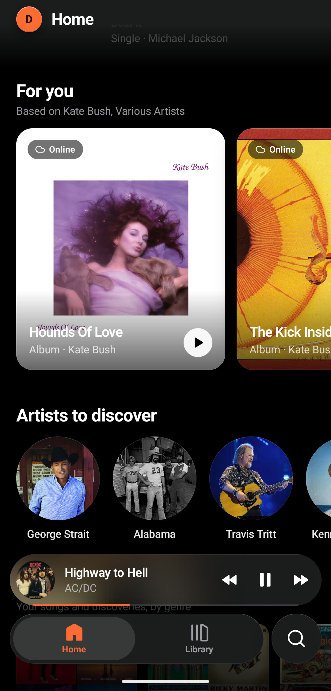 |  |

| Player | Synced lyrics | Queue |
|---|---|---|
|  |  | 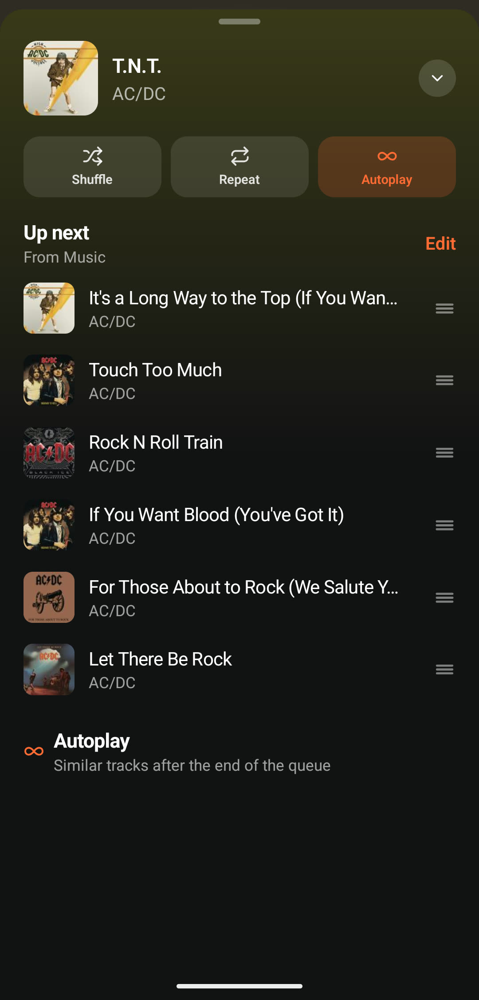 |

| Search | Search results | Artist |
|---|---|---|
| 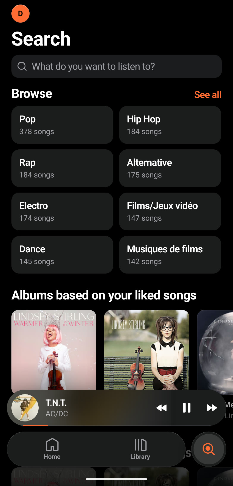 |  | 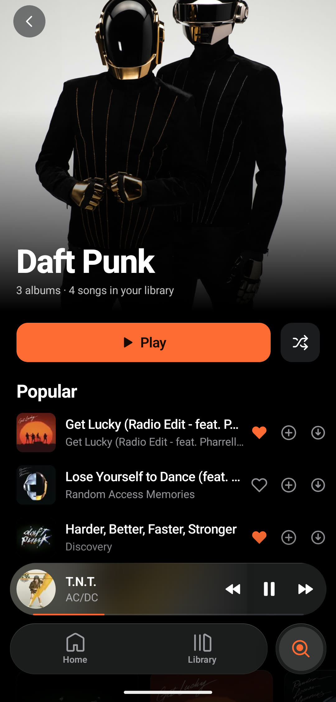 |

| Library | Library · Grid | Liked Songs |
|---|---|---|
|  | 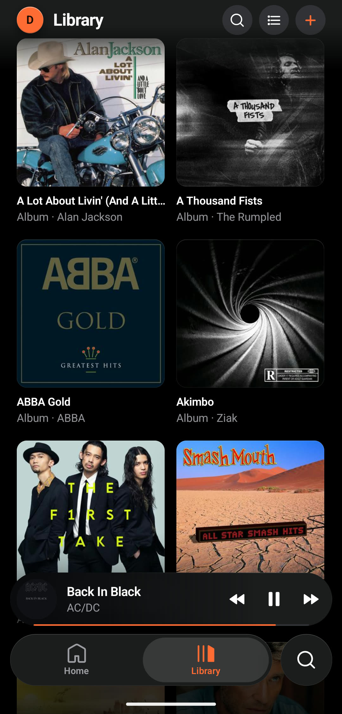 | 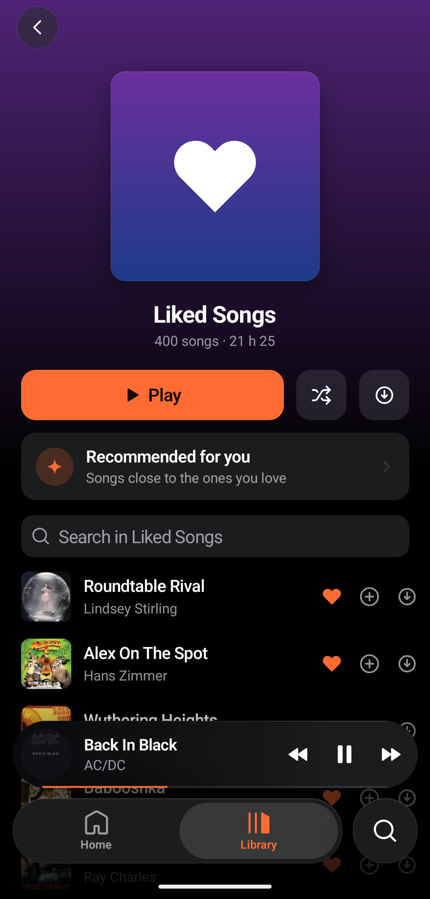 |

| Album | Playlist | Settings |
|---|---|---|
|  | 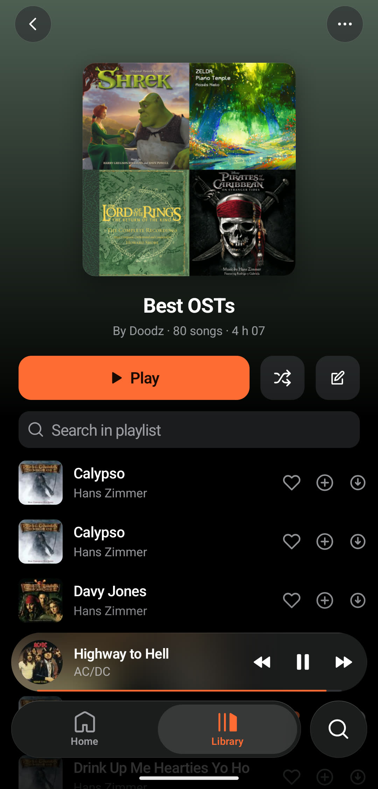 | 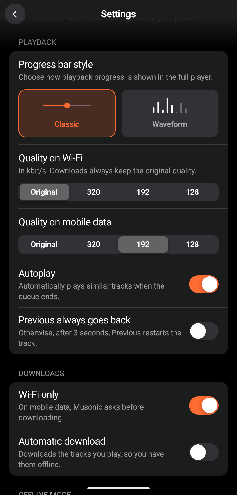 |

<details>
<summary><b>Landscape screenshots</b></summary>

| Home | Player | Liked Songs |
|---|---|---|
| 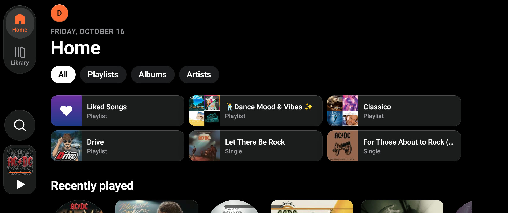 | 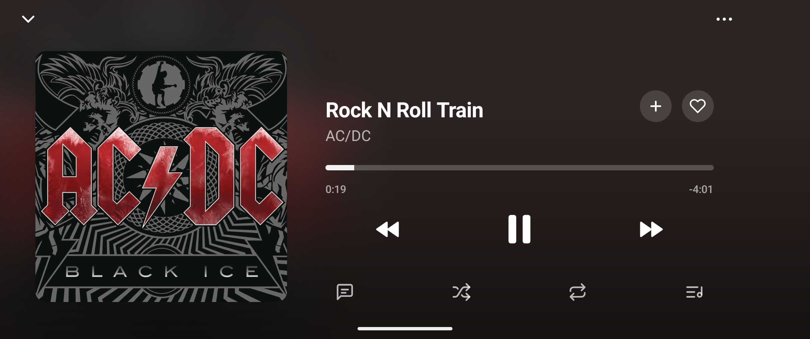 | 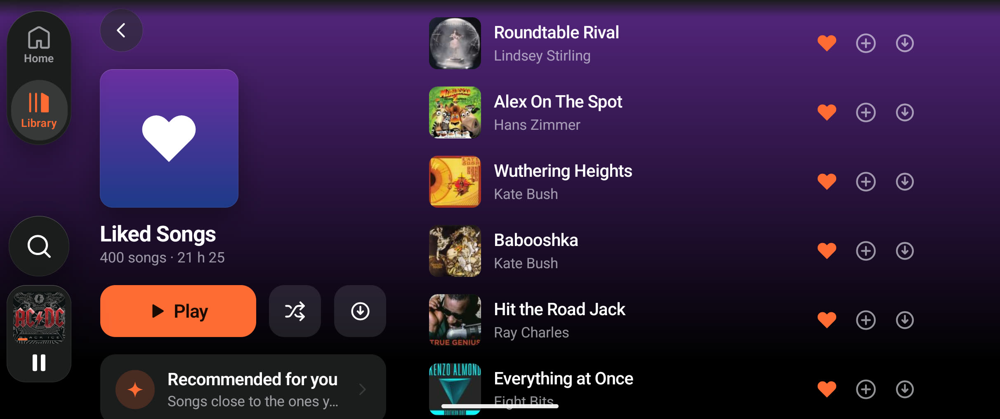 |

</details>

More screenshots on the [presentation website](https://doodzprog.github.io/Musonic/).

---

## Install

| App | How |
|---|---|
| **Android** 7.0+ | Download [`Musonic.apk`](https://github.com/DoodzProg/Musonic/releases/latest/download/Musonic.apk) from the latest release and open it. The app tells you when a new version is out. |
| **iOS** 15.1+ | Unsigned IPA, [`Musonic.ipa`](https://github.com/DoodzProg/Musonic/releases/latest/download/Musonic.ipa), to install with AltStore or Sideloadly. No App Store release is planned. |
| **Web client** | The Musonic app in a browser, for desktop. In development, not released yet: see [`apps/web`](apps/web/README.md). |

No account, no cloud and no API key: Musonic only talks to your own server, plus the public Deezer API for artist photos and recommendations.

---

## Connect your server

On first launch, enter:

| Field | Value |
|---|---|
| Server URL | `https://music.example.com` |
| Username | your Navidrome username |
| Password | your Navidrome password |

Musonic tells you clearly what went wrong (wrong password, server not found, not a Subsonic server…). More accounts can be added later from your profile.

### Online catalogue (optional)

With [OctoFiesta](https://github.com/V1ck3s/octo-fiesta), a Subsonic-compatible layer in front of Navidrome, tracks, albums and artists from the online catalogue can be played and liked like your own. Setup is the same as above, with the OctoFiesta address. Online items are marked *Online* and handled transparently (`ext-` ids).

---

## Privacy

- Your server address and password stay on your phone and are only sent to your own server. Use an `https://` address so they are encrypted on the way.
- To find artist photos, recommendations and lyrics, Musonic sends **artist and track names only** to the public [Deezer API](https://developers.deezer.com/api) and [LRCLIB](https://lrclib.net). No account, no identifier, no listening history.
- No analytics, no crash reporting, no ads. The only other request is a check of this repository's releases for updates.

---

## Repository layout

A single repository for every Musonic app ([monorepo](https://github.com/DoodzProg/Musonic/tree/main)):

```
apps/
├── mobile/      React Native app (Android, iOS)
└── web/         Web client (Vite + React)
packages/
└── core/        Shared TypeScript: Subsonic client, home feed engine, release tags
docs/            Presentation website (GitHub Pages), not the web client
```

Inside the mobile app (`apps/mobile/src`):

```
api/           Subsonic client, Deezer, endpoints
components/    ui/ (design system), player/, detail/, shell/ (Dock, profile), icons/
hooks/         Player setup, home feed, library, play button…
i18n/          fr.ts and en.ts (same keys, checked by a test)
navigation/    Root navigator, tabs with Dock and Rail, stacks
screens/       Home, Search, Library, Album, Artist, Playlist, Mix, Liked Songs,
               My Music, Recommendations, Settings, Server setup
services/      Playback engine, background service, downloads gate, network
store/         Zustand stores persisted with MMKV
theme/         Design tokens: colours, type, shadows, motion
```

---

## Development

### Mobile

| Requirement | Version |
|---|---|
| Node.js | 22.13 or later (`apps/mobile/.nvmrc`) |
| JDK | 17 and 21 |
| Android SDK / NDK | 36 / 27.1 |
| Xcode (iOS) | 16+, macOS only |

```bash
git clone https://github.com/DoodzProg/Musonic.git
cd Musonic/apps/mobile
npm ci                        # also applies the patches in patches/

npm start                     # terminal 1: Metro
adb reverse tcp:8081 tcp:8081
npm run android               # terminal 2
```

iOS: `bundle install && cd ios && bundle exec pod install && cd .. && npm run ios`.

Checks, from `apps/mobile`:

```bash
npx tsc --noEmit
npx eslint . --max-warnings 0
npm test
```

### Web and shared core

From the repository root (Node 24, `.nvmrc`):

```bash
npm ci
npm run web          # http://localhost:5173
npm run test:core    # tests of packages/core
```

---

## Releases and CI

Each app is released on its own, from `main`, with its own tag prefix:

| Tag | Release | Built by |
|---|---|---|
| `mobile-vX.Y.Z` | *Musonic Mobile X.Y.Z*: signed APK and unsigned IPA | `android-release.yml`, `ios-release.yml` |
| `web-vX.Y.Z` | *Musonic Web X.Y.Z* | (coming) |

The in-app update prompt only looks at its own app's tags. Every push and pull request runs the checks of the parts it touches: `ci.yml` (mobile and core) and `ci-web.yml` (web and core).

Signing secrets for the Android workflow (Settings → Secrets → Actions): `KEYSTORE_BASE64`, `KEYSTORE_PASSWORD`, `KEY_ALIAS`, `KEY_PASSWORD`.

To build a signed APK locally, put `keystore.properties` and the keystore in `apps/mobile/android/` (both git-ignored, keep an offline backup), then:

```bash
cd apps/mobile/android
./gradlew assembleRelease
# apps/mobile/android/app/build/outputs/apk/release/app-release.apk
```

---

## Architecture notes

- **Playback engine** (`services/playback/`): one entry point, `playContext`, builds the queue from pure, unit-tested rules (zones for *added by you* and the context, shuffle, Shuffle Magic, repeat, previous). React Native Track Player 4.1.2 plays the audio; the engine is the only one to change its queue. The queue is saved and restored on reopen.
- **New Architecture** (Fabric + TurboModules) everywhere. React Native Track Player is patched for it (`patches/`), including a guard so Android 12+ cannot crash the app by refusing a foreground start.
- **Design system** in `components/ui`: tokens, `Text`, `Button`, `ListGroup`, `Sheet`, `TrackRow`, glass surfaces, skeleton loaders. Animations run on the UI thread with Reanimated; nothing animates in a loop while idle.
- **Shared core** (`packages/core`): the Subsonic client with token authentication, the home feed engine and the release tag reader, used by the mobile app and the web client.
- **Offline**: MMKV persistence for settings, library, playlists and downloads; a connectivity monitor switches to offline mode after repeated failures and back when the server answers.
- **Credentials**: stream and cover URLs carry the credentials, so they are built in memory only, never stored or logged. The player and Android Auto only get `content://` cover addresses served by the app itself.

---

## Known limitations

| Topic | Status |
|---|---|
| iOS | Unsigned IPA only (AltStore, Sideloadly); tested far less than Android. |
| Android Auto | Beta since 2.0.1: playlists, playback and Shuffle / Repeat / Like buttons. Musonic is not on the Play Store, so turn on *Unknown sources* in Android Auto's developer settings. |
| Memory | Image caches can grow to about 900 MB on long sessions with large libraries; being worked on. |
| Web client | Early stage, not released yet. |
| Online catalogue | Needs OctoFiesta in front of Navidrome. |

---

## Contributing

Bug reports and ideas are welcome: open an [issue](https://github.com/DoodzProg/Musonic/issues/new/choose) (templates for bugs and features). For code, read [CONTRIBUTING.md](CONTRIBUTING.md) first: branches, commit style and checks.

---

## License

[CC BY-NC 4.0](LICENSE): free to use and adapt for personal, non-commercial purposes. Commercial use is prohibited.

---

## Made by

**[DoodzProg](https://github.com/DoodzProg)**: designed, built, and shipped from scratch.

*Built with passion. Debugged with patience. Shipped with pride.*
